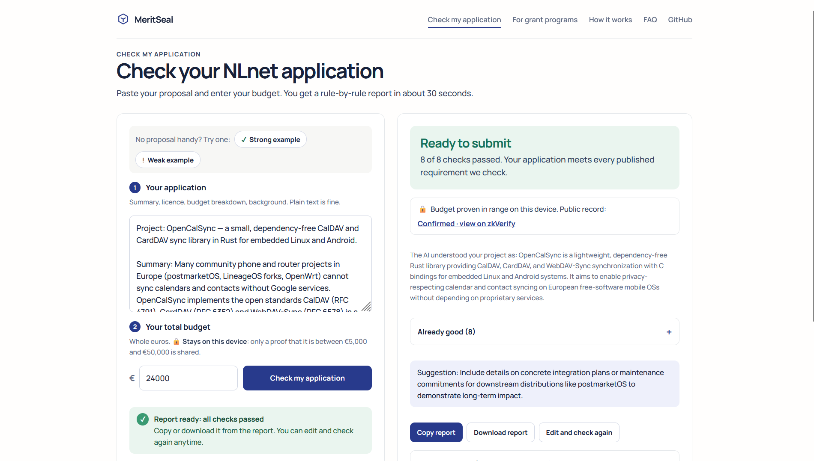
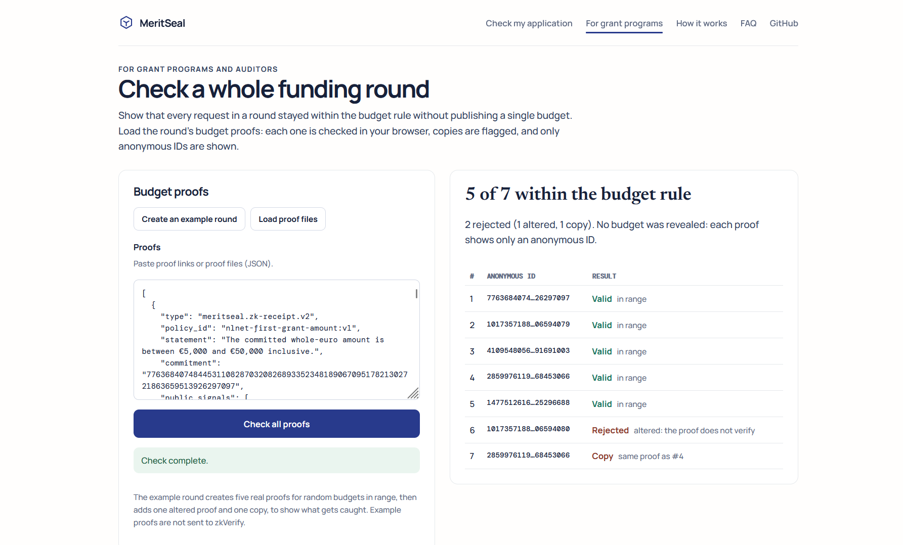
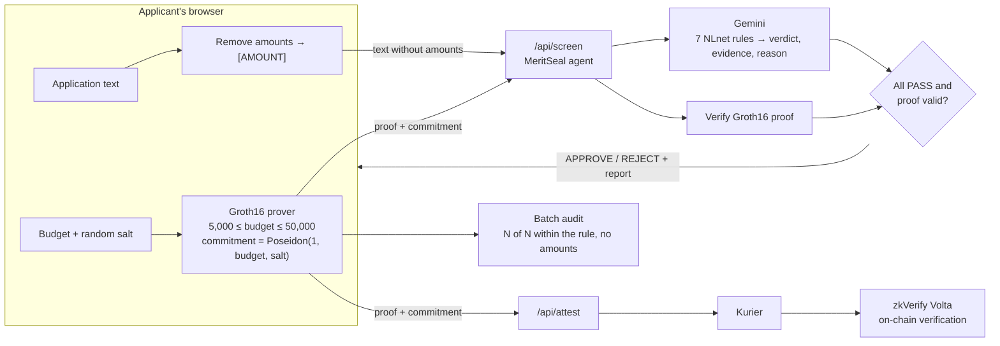

<p align="center"></p>

<h1 align="center">MeritSeal</h1>
<p align="center"><b>An AI agent that checks grant applications against the funder's published rules, while the applicant's budget stays private.</b><br>The budget is proven in range with a zero-knowledge proof and verified on zkVerify. The agent and the AI model never see it.</p>

<p align="center">
  <a href="https://meritseal.vercel.app/#screen"></a>
  <a href="https://meritseal.vercel.app/#audit"></a>
  
  
</p>

[](https://meritseal.vercel.app/#screen)

Built for the **zkVerify Agent Games, Wildcard track**. Live: **https://meritseal.vercel.app**. No wallet or crypto is needed to use it.

## For reviewers: where to find each criterion

| Wildcard criterion | Where to see it |
| --- | --- |
| **Useful problem** | [The problem](#the-problem): applicants need a pre-check against the funder's rules, and grant programs need to show compliance without publishing budgets. |
| **Working implementation** | Live at [meritseal.vercel.app/#screen](https://meritseal.vercel.app/#screen). Select **Strong example**: it fills in a sample application and runs the check (about 15 s). The agent code is in [`agent/`](./agent), and [16 automated tests](#tests) cover it. |
| **Clear explanation** | [What the agent does](#what-the-agent-does), [what it can and cannot do](#what-it-can-and-cannot-do), [how it works](#how-it-works), [key design decisions](#key-design-decisions) and [limitations](#limitations). |
| **Verifiability (zkVerify)** | Each budget proof is a Groth16 proof verified on zkVerify Volta through Kurier. Example finalized transaction: [`0x8cbc2d54…16ba7afc`](https://zkverify-testnet.subscan.io/extrinsic/0x8cbc2d54acf347b4f44f8878197930d841bfad845a6b0c3666d6941616ba7afc). The circuit is [`proof/nlnet-amount.circom`](./proof/nlnet-amount.circom), and the key manifest is at [`/zk/manifest.json`](https://meritseal.vercel.app/zk/manifest.json). |
| **Public endpoint** | `POST https://meritseal.vercel.app/api/screen` (AI screening) and `POST /api/agent` (Agent Games, HMAC-signed). Opening either URL in a browser returns its usage. See [Agent API](#agent-api). |
| **Public share (bonus)** | [Launch post](https://x.com/thesithunyein/status/2124376805994102840), [Part 1 article](https://x.com/thesithunyein/status/2123797328322781412) and [Part 2 article](https://x.com/thesithunyein/status/2124391654182535274) on X. |

## The problem

Grant applicants, often individual open-source developers, send proposals that get rejected for avoidable reasons: no open licence, no budget breakdown, a budget outside the allowed range. Funders publish their rules, but nobody checks an application against them before it is sent.

Grant programs face the opposite problem. They are asked to show that every request in a round followed their rules. The obvious way to prove that is to publish each budget, but budgets reveal salaries, rates and runway, so programs either publish everything or ask the public to trust them.

MeritSeal handles both. It starts with [NLnet](https://nlnet.nl/propose/), a European fund for open-source technology with clear published requirements.

**Who it helps**
- **Applicants**: get a rule-by-rule report with evidence and a suggestion before submitting. Their budget is proven to be in range without being disclosed.
- **Grant programs and auditors**: check a whole round's budget proofs and show "N of N within the rule" without seeing any amount.

## Try it in two minutes

1. **Check an application.** Open [meritseal.vercel.app/#screen](https://meritseal.vercel.app/#screen), select **Strong example** (it fills in a sample application and runs the check). You see four progress steps, then a report: *Ready to submit*, 8 of 8 checks passed, each with the quote it relied on, and a public zkVerify record for the budget proof. Open **What the AI saw** to confirm every amount was replaced with `[AMOUNT]`.
2. **Try a weak application.** Select **Weak example**. It asks for fixes: the budget is above €50,000 (no proof can be made), the code is proprietary, the work is marketing rather than technical development, there is no budget breakdown or European dimension, and the text says it was AI-generated.
3. **Audit a round.** Open [#audit](https://meritseal.vercel.app/#audit) and select **Create an example round**. It reports *5 of 7 within the budget rule*: one altered proof and one reused proof are caught, and only anonymous IDs are shown.

[](https://meritseal.vercel.app/#audit)

## What the agent does

1. **Removes amounts.** The browser replaces every amount in the application with `[AMOUNT]` before sending it, and the server does it again. Standard identifiers such as `RFC 4791` are kept.
2. **Proves the budget privately.** The browser creates a Groth16 proof that the budget is between €5,000 and €50,000. A budget outside the range cannot produce a proof.
3. **Reads and judges.** Gemini checks seven requirements published on [nlnet.nl/propose](https://nlnet.nl/propose/): technical development, open licence, open standards, budget breakdown (structure, not numbers), European dimension, written by a human, and plain English. Each rule gets PASS, NEEDS_INFO or FAIL, plus a quote from the application and a reason.
4. **Decides.** It returns `APPROVE / SCREEN_PASSED` only if all seven rules pass **and** the budget proof verifies. Otherwise it returns `REJECT` with the reason (`SCREEN_NEEDS_WORK`, `SCREEN_NOT_READY` or `BUDGET_PROOF_MISSING`) and one concrete suggestion.
5. **Records the proof publicly.** The budget proof is submitted to zkVerify, so a funder or auditor can confirm it later.

## What it can and cannot do

| It can | It cannot |
| --- | --- |
| Check an application against seven of NLnet's published requirements and quote its evidence | Decide eligibility: NLnet decides, and the report is advisory |
| Prove the budget is within €5,000–€50,000 without revealing it | Judge the merit or quality of a proposal |
| Record each budget proof on zkVerify for later checking | Guarantee the AI is right: each verdict shows its quote so a person can check it |
| Let an auditor check many proofs at once and catch altered or reused ones | Prove that a committed budget equals the one in the final application: the applicant's secret file does that, if the funder asks |
| Run without a wallet, account or crypto | Screen against funders other than NLnet yet: the rules are data in [`agent/screen.mjs`](./agent/screen.mjs), so adding a funder means adding a rule list |

## How it works



- **Circuit** ([`proof/nlnet-amount.circom`](./proof/nlnet-amount.circom)): private `amount` and `salt`, public output `commitment = Poseidon(1, amount, salt)`. The amount is constrained to 16 bits, then to `5000 ≤ amount ≤ 50000`.
- **Budget proof** (`meritseal.zk-receipt.v2`): `policy_id`, `commitment`, `proof`, `public_signals`, `vkey_sha256`, `issued_at` and zkVerify `job_id` / `tx_hash`. The "in range" result comes from the proof itself, not from any text field.
- **zkVerify**: the server re-verifies each proof before relaying it (so junk never reaches the chain), registers the verification key once at boot, submits through [Kurier](https://docs.zkverify.io/overview/getting-started/kurier) and polls the job until it is finalized.
- **AI safety**: the model's output is constrained to the seven known rule IDs and three verdicts; anything else becomes NEEDS_INFO. Text in the application is treated as data, not instructions. All model output is rendered with `textContent`, never as HTML.
- **Key transparency**: [`/zk/manifest.json`](https://meritseal.vercel.app/zk/manifest.json) publishes the circuit, the verification-key SHA-256 and how the key was generated. Proofs made under a different key are rejected.

## Key design decisions

- **Prove the one number, let the AI read the rest.** Six of NLnet's requirements are about meaning (licence, scope, standards) and suit a language model. The budget rule is a number that must stay private, so it is decided by a zero-knowledge proof, not by the model.
- **Redact twice.** Amounts are removed in the browser and again on the server, so a bug in one place does not leak a budget. Standard identifiers such as `RFC 4791` are kept, because the open-standards check needs them.
- **Prove in the browser.** The proof is generated on the applicant's device, so the budget never reaches MeritSeal's server. The server only re-checks the proof.
- **Constrain the model.** The prompt treats the application as data, and the output is validated against seven fixed rule IDs and three verdicts. Every verdict must quote its evidence, so a person can check the AI.
- **Approve only on both.** `APPROVE` needs all seven rules to pass **and** a valid proof. Errors fail closed: no verifier or no model means `REJECT`, never a silent pass.
- **zkVerify for the public record.** Verifying each proof on zkVerify (through Kurier) gives funders and auditors an independent, permanent check, and keeps on-chain verification cheap compared with a general-purpose chain. The applicant needs no wallet: the service pays for the submission.
- **Rules as data.** The seven rules live in one list in [`agent/screen.mjs`](./agent/screen.mjs), each with NLnet's own wording, so adding another funder means adding another list.

## Agent API

| Endpoint | Input | Output |
| --- | --- | --- |
| `POST /api/screen` | `{ application_text, receipt? }` | `decision`, `reason_code`, rule-by-rule `assessment`, `budget` check. Public and rate-limited. |
| `POST /api/agent` | Agent Games signed task: `{ task_id, input: { application_text, receipt? } }` or `{ input: { policy_id: "nlnet-first-grant-amount:v1", receipt } }` | HMAC-signed decision; idempotent on `task_id`; preflight supported |
| `POST /api/agent/check` | `{ proof, public_signals }` | The agent's decision on a budget proof (`APPROVE / ZK_PROOF_VALID`). Public. |
| `POST /api/attest`, `GET /api/attest/:job` | `{ proof, public_signals }` | zkVerify job id, then status and transaction hash |
| `GET /api/screen/rules` | none | The seven rules, with NLnet's wording |
| `GET /api/health` | none | Which components are configured |
| `GET` on any endpoint above | none | A short description of how to call it |

It fails closed: malformed proofs return `INVALID_RECEIPT`, a missing verifier returns `VERIFIER_UNAVAILABLE`, a model outage returns `SCREENING_UNAVAILABLE`, and a bad signature returns 401.

## Privacy: what leaves the device

| Data | Where it goes |
| --- | --- |
| Budget amount | Nowhere. Only the proof and an anonymous commitment are sent. |
| Application text | To the MeritSeal server and Google Gemini, **with amounts removed**. It is not stored. The report shows exactly what the AI saw. |
| Budget proof | To zkVerify (public), so it can be checked later |
| Secret file (amount + salt) | Only to the applicant's own downloads, if they choose to save it |

## Tests

`npm test` runs 16 tests ([`agent/server.test.mjs`](./agent/server.test.mjs)), including:
- **the AI model never receives budget amounts**: the request sent to Gemini is inspected, and `24,000`, `8,400` and `€60` must not appear;
- model output is constrained to known rules and verdicts (an injected rule or an unknown verdict is ignored);
- the agent approves only with all rules passed **and** a valid budget proof;
- Agent Games HMAC signing, preflight, idempotency, and rejection of malformed or unsigned requests;
- malformed proofs are rejected and the agent fails closed without a verifier;
- Gemini is retried once on a timeout, 429 or 5xx;
- only whitelisted files are served, and a browser visit to an endpoint returns its usage.

`npm run zk:check` proves €5,000, €12,000 and €50,000, confirms €4,999, €50,001 and €70,000 cannot be proven, and confirms a changed commitment fails verification.

## Run locally

Requires Node 20+ and [circom 2.1.6+](https://docs.circom.io/getting-started/installation/).

```bash
npm install
npm run zk:setup      # compile the circuit, run the Groth16 setup, write agent/public/zk/*
npm run zk:check      # boundary proofs (see Tests)
npm test
cp .env.example .env  # GEMINI_API_KEY, KURIER_API_KEY, optional AGENT_GAMES_HMAC_SECRET
npm start             # http://localhost:3000
```

Deployed on Vercel as a container ([`Dockerfile`](./Dockerfile)).

## Repository map

```
agent/
  server.mjs          HTTP server: routes, Agent Games HMAC signing, rate limits, static files
  screen.mjs          AI screening: NLnet rules, amount redaction, Gemini call, output validation
  policy.mjs          Decisions: screening + budget proof, proof verification, legacy rule checks
  kurier.mjs          zkVerify submission through Kurier (register key, submit, status)
  server.test.mjs     16 tests
  public/index.html   The web app (applicant flow, audit, budget proof)
  public/zk-receipt.js  Browser logic: redaction, proving, report, audit
  public/zk/          Circuit WASM, proving key, verification key, manifest
proof/
  nlnet-amount.circom The budget range circuit
  setup.mjs           Builds the key and browser artifacts
  verify-boundaries.mjs  Boundary and tamper checks
```

## Limitations

- **One funder.** The seven rules come from NLnet's public page. Other funders need their own rule list.
- **Advisory AI.** The AI can misread a proposal. Each verdict shows its quote so a person can check it. NLnet makes its own decisions.
- **Single-party key setup.** The Groth16 key was generated by one person (see [`/zk/manifest.json`](https://meritseal.vercel.app/zk/manifest.json)). Production use should run a multi-party ceremony.
- **Commitment binding.** A proof shows the *committed* budget is in range. Linking it to the budget in the final application is done with the applicant's secret file, if the funder asks.
- **Testnet.** zkVerify submissions use the Volta testnet.
- **Model data.** On Google's free tier, prompts may be used to improve Google's models. Amounts are removed first, but real deployments should use a paid key.

## Written up in public

- [Part 1: What can a private grant receipt actually prove?](https://x.com/thesithunyein/status/2123797328322781412) shows why a checksum receipt was not enough.
- [Part 2: Can an AI agent prove what it tells you?](https://x.com/thesithunyein/status/2124391654182535274) covers the zero-knowledge proofs, zkVerify and the AI agent.
- [Technical walkthrough](./docs/creator-walkthrough.md)

## Project policies

[Security](./SECURITY.md) · [Code of conduct](./CODE_OF_CONDUCT.md) · [MIT license](./LICENSE)
