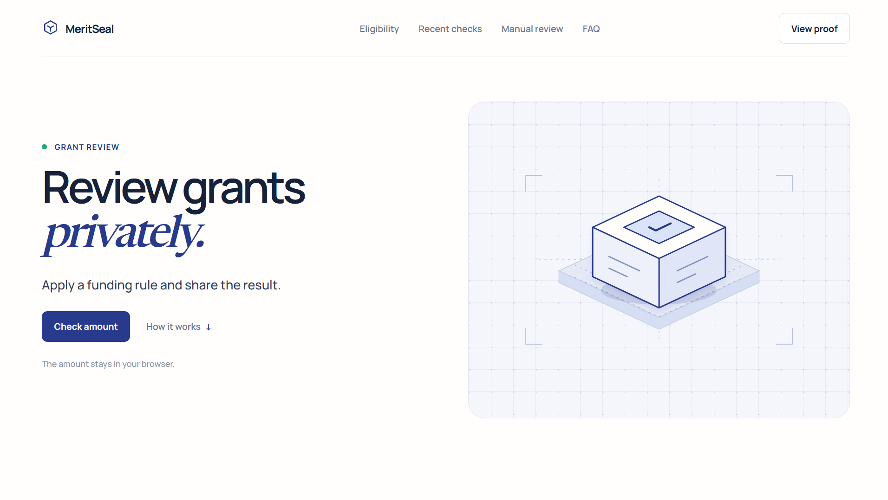
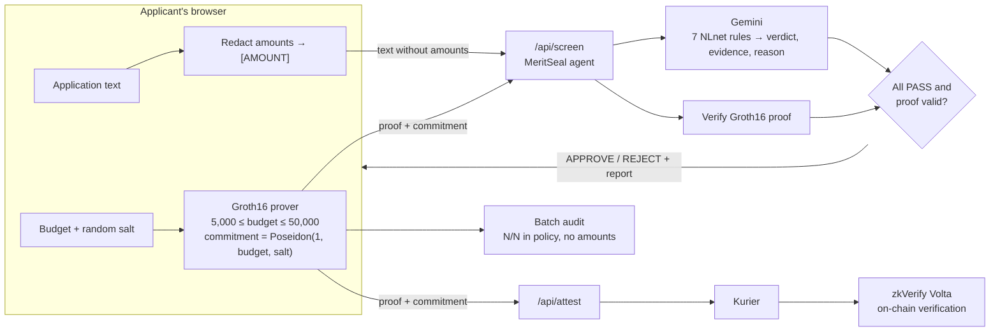

<p align="center"></p>

<h1 align="center">MeritSeal</h1>
<p align="center">An AI agent that screens grant applications against the funder&rsquo;s rules, while the budget is proven with zero knowledge and never seen.</p>

<p align="center">
  <a href="https://meritseal.vercel.app/#screen"></a>
  <a href="https://meritseal.vercel.app/#audit"></a>
  <a href="./docs/creator-walkthrough.md"></a>
</p>

[](https://meritseal.vercel.app/)

## The problem

Grant programs (foundations, DAOs, public-goods funds) are asked to show that every request and award follows their published rules. The obvious way to show that is to publish each budget, but grantees often can't do that: budgets reveal salaries, rates and runway. Today programs pick one side: they publish everything, or they ask the public to trust them.

MeritSeal lets an applicant **prove** a rule holds without disclosing the number. The first rule is NLnet's published first-grant range: the requested amount must be €5,000–€50,000 ([NLnet application form](https://nlnet.nl/propose/)).

**Who it helps:**
- **Applicants** get an AI pre-screen of their proposal against the funder's published requirements before they submit. The budget is proven in range with zero knowledge, so neither the agent nor the AI model sees it.
- **Grant programs and auditors** check a whole round's receipts and confirm each one is in policy, without seeing any amounts.

## What the agent does

1. **Reads** the application. The browser first replaces every amount with `[AMOUNT]`, and the server does the same again.
2. **Checks** it against NLnet's published requirements ([nlnet.nl/propose](https://nlnet.nl/propose/)) with Gemini: technical development, open licence, open standards, budget breakdown (structure, not numbers), European dimension, human authorship with AI use disclosed, and plain English. Each rule gets a verdict (PASS, NEEDS_INFO or FAIL), a quote from the application as evidence, and a reason.
3. **Proves** the one rule that needs the secret number: the budget is within €5,000–€50,000. The browser builds a Groth16 proof and the server submits it to zkVerify.
4. **Decides**: it returns `APPROVE / SCREEN_PASSED` only when every rule passes *and* the budget proof is valid, otherwise `REJECT` with the reason. It then suggests one concrete improvement.

The model's output is constrained to the known rules and verdicts. Anything else becomes NEEDS_INFO. Text inside the application is treated as data, not instructions. The AI's verdicts are advisory; NLnet decides eligibility.

## Try it in under a minute

**AI screening:** open [meritseal.vercel.app/#screen](https://meritseal.vercel.app/#screen), select **Load strong sample**, then **Screen application**. You get a rule-by-rule report, and the budget row links its zkVerify transaction. Expand "What the AI model saw" to confirm no amounts were sent. Then try **Load weak sample**: proprietary code, marketing spend, a €55,000 budget (no proof is possible) and an AI-written proposal.

**Batch audit:** open [#audit](https://meritseal.vercel.app/#audit) and select **Generate demo round**. You see five valid receipts, one tampered receipt and one reused receipt, so 5/7 are within policy, and no amounts are shown.

**ZK receipt only:**

1. Open **[meritseal.vercel.app/#zk](https://meritseal.vercel.app/#zk)** and select **Try €12,000**. Your browser generates a Groth16 proof (a few seconds). The amount is never sent anywhere.
2. The receipt shows the policy, a Poseidon commitment and the proof, then the zkVerify status as the proof is verified on-chain (Queued → … → Finalized, with a Subscan link).
3. Select **Copy receipt link** and open it in another browser. The proof is verified there against the published key, and the amount appears nowhere.
4. Select **Try €55,000**. No proof can be generated, because the circuit rejects out-of-range amounts.
5. Edit any digit of the proof or commitment in **Check a receipt** → **Invalid**.

## How it works



- **Circuit** (`proof/nlnet-amount.circom`): private `amount` and `salt`; public output `commitment`. It constrains the amount to 16 bits, then `5000 ≤ amount ≤ 50000`. The commitment lets the applicant later open the exact amount to the funder (the "private opening" file) while nobody else learns it.
- **Receipt** (`meritseal.zk-receipt.v2`): `policy_id`, `commitment`, `proof`, `public_signals`, `vkey_sha256`, `issued_at`, and zkVerify `job_id` / `tx_hash`. The "in range" result comes from the proof itself. No field of the receipt is trusted text.
- **zkVerify**: the server re-verifies each proof locally (so junk never reaches the relay), registers the verification key once, submits via Kurier, and returns the job status and transaction hash.
- **Key transparency**: `/zk/manifest.json` publishes the circuit, the verification-key SHA-256 and how the key was generated. Receipts made under a different key are rejected.

## The agent

`POST /api/agent` is an [Agent Games](https://agentgames.zkverify.io) endpoint: HMAC-signed requests and responses, idempotent task IDs, deadline handling and preflight.

| Task input | Decision |
| --- | --- |
| `{ application_text, receipt? }` | AI screening against NLnet's rules plus the ZK budget proof. Returns `APPROVE / SCREEN_PASSED` or `REJECT` with `SCREEN_NEEDS_WORK`, `SCREEN_NOT_READY` or `BUDGET_PROOF_MISSING`, and the full rule-by-rule assessment |
| `{ policy_id: "nlnet-first-grant-amount:v1", receipt: { proof, public_signals } }` | Verifies the Groth16 proof and returns `APPROVE / ZK_PROOF_VALID` plus the commitment. **It never sees the amount.** |
| `{ policy_id: "nlnet-first-grant-amount:v1", amount_eur }` | Plain range check (`AMOUNT_IN_RANGE` / `AMOUNT_OUT_OF_RANGE`) |
| `{ policy: { rules }, application }` | Generic versioned rule evaluation (`equals`, `gte`, `lte`, `includes`, …) |

Reviewers can watch it run without Agent Games credentials: `POST /api/agent/check` with a receipt returns the same decision, unsigned and rate-limited, and the live site calls it whenever a receipt is verified.

It fails closed: malformed receipts → `INVALID_RECEIPT`; a missing verifier or key → `VERIFIER_UNAVAILABLE`; bad signatures → 401.

## Run locally

Requires Node 20+ and [circom 2.1.6+](https://docs.circom.io/getting-started/installation/).

```bash
npm install
npm run zk:setup      # compile circuit, Groth16 setup, write agent/public/zk/*
npm run zk:check      # €5,000/€12,000/€50,000 prove & verify; €4,999/€50,001/€70,000 cannot prove; tampering rejected
npm test              # agent, signing, receipt handling, static serving
cp .env.example .env  # KURIER_API_KEY, GEMINI_API_KEY, optional AGENT_GAMES_HMAC_SECRET
npm start             # http://localhost:3000
```

Deployed as a container (`Dockerfile`). Health: `GET /api/health` reports `secretConfigured`, `zkVerifierLoaded` and `attestationConfigured`.

## Limitations

- One criterion only. NLnet decides eligibility and awards. MeritSeal proves the amount rule, not the merit of a proposal.
- The Groth16 key comes from a single-party setup (details in `/zk/manifest.json`). A production deployment should run a multi-party phase-2 ceremony.
- A receipt proves the *committed* amount is in range. Binding that commitment to the amount in the actual application is the funder's step, done with the private opening.
- zkVerify submission uses the Volta testnet.
- The screening uses Gemini; on Google's free tier, prompts may be used to improve Google's models. Amounts are removed first, but deploy with a paid key for real applications. Seven rules are checked from NLnet's public page, and the AI can be wrong, so treat its report as a pre-check.

## Project policies

[Security](./SECURITY.md) · [Code of conduct](./CODE_OF_CONDUCT.md) · [MIT license](./LICENSE)
