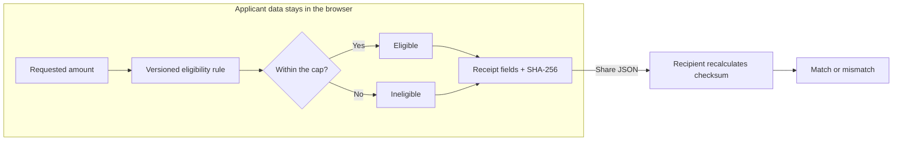

<p align="center"></p>

<h1 align="center">MeritSeal</h1>
<p align="center">Private grant eligibility receipts</p>

<p align="center">
  <a href="https://meritseal.vercel.app/#review"></a>
  <a href="./docs/creator-walkthrough.md"></a>
</p>

Grant reviewers need to explain eligibility decisions without sharing private application details. MeritSeal applies a versioned rule in the browser and issues a receipt with the policy ID, outcome, timestamp, and SHA-256 checksum. The requested amount stays on the device.

## Try it in under a minute

1. Open the [live eligibility checker](https://meritseal.vercel.app/#review). Try **$4,200** to pass the illustrative **$5,000** cap.
2. Click **Use generated receipt**, then **Check checksum**. Expect **Checksum matches**.
3. Change `Eligible` to `Ineligible` in the checker while keeping the checksum unchanged. Check again and expect a mismatch.
4. Try **$6,000** to see a request fail the same rule.

## How it works



The checksum detects edits when compared against the original checksum. Anyone can recompute it, so it does not authenticate the issuer or independently prove that the rule was applied correctly. The live checker uses a sample grant policy. Independent zkVerify verification is future work.

## Agent service

The Agent Games callback is separate from the browser checker. It validates signed requests and evaluates explicit policy rules deterministically. Production signed preflight and practice have not been confirmed.

| Method | Route | Purpose |
| --- | --- | --- |
| GET | [`/api/health`](https://meritseal.vercel.app/api/health) | Service and signing configuration status |
| POST | `/api/agent` | Signed Agent Games callback |

## Run locally

Node.js 20 or later.

```bash
npm test
npm start
```

Open `http://localhost:3000/`. For signed callback testing, set `AGENT_GAMES_HMAC_SECRET` in the service environment. Keep production secrets out of the repository. The retry cache is in memory.

[Read the technical walkthrough](./docs/creator-walkthrough.md)
