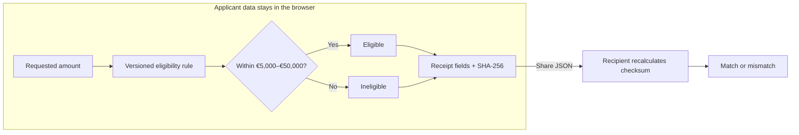

<p align="center"></p>

<h1 align="center">MeritSeal</h1>
<p align="center">Private grant eligibility receipts</p>

<p align="center">
  <a href="https://meritseal.vercel.app/#review"></a>
  <a href="./docs/creator-walkthrough.md"></a>
</p>

## Problem

Grant reviewers need to explain eligibility decisions without sharing private application details. MeritSeal applies a versioned rule in the browser and issues a receipt with the policy ID, outcome, timestamp, and SHA-256 checksum. The requested amount stays on the device.

## Published rule

[NLnet’s application form](https://nlnet.nl/propose/) sets a €5,000–€50,000 range for first grant requests. MeritSeal tracks this one amount check as `nlnet-first-grant-amount:v1`. A reviewer can share the result without disclosing the budget. NLnet determines overall eligibility and funding.

## Try it in under a minute

1. Open the [live eligibility checker](https://meritseal.vercel.app/#review). Try **€12,000** to pass the published range.
2. Click **Use generated receipt**, then **Check checksum**. Expect **Checksum matches**.
3. Change `Within range` to `Outside range` in the checker while keeping the checksum unchanged. Check again and expect a mismatch.
4. Try **€55,000** to see a request fail the same rule.

## How it works



The checksum detects edits when compared against the original checksum. Anyone can recompute it, so it does not authenticate the issuer or independently prove that the rule was applied correctly. The [NLnet proof circuit and verification workflow](./proof/README.md) are in development. The live receipt uses a checksum. A separate synthetic testnet proof is linked below.

## Agent service

The browser checker and signed Agent Games callback use the same NLnet amount evaluator. The callback accepts `input.policy_id` set to `nlnet-first-grant-amount:v1` and an integer `input.amount_eur`. It validates signed requests and evaluates explicit policy rules deterministically. Production signed preflight and practice have not been confirmed.

| Method | Route | Purpose |
| --- | --- | --- |
| GET | [`/api/health`](https://meritseal.vercel.app/api/health) | Service and signing configuration status |
| POST | `/api/agent` | Signed Agent Games callback |

## Run locally

Node.js 20 or later.

```bash
npm test
npm start
```

Open `http://localhost:3000/`. For signed callback testing, set `AGENT_GAMES_HMAC_SECRET` in the service environment. Keep production secrets out of the repository. The retry cache is in memory.

[Read the technical walkthrough](./docs/creator-walkthrough.md)

## Project policies

[MIT license](./LICENSE) · [Security policy](./SECURITY.md) · [Code of conduct](./CODE_OF_CONDUCT.md)

## Finalized testnet example

[View zkVerify Volta transaction](https://zkverify-testnet.subscan.io/extrinsic/0xc480960248cd345a95f6b2b862d397445b475ed7a2c4149f54e12320bd5f29ea). Kurier reported `Finalized`. This synthetic example uses a development Groth16 setup. The transaction applies to the sample only. Browser-generated receipts still use checksums.
